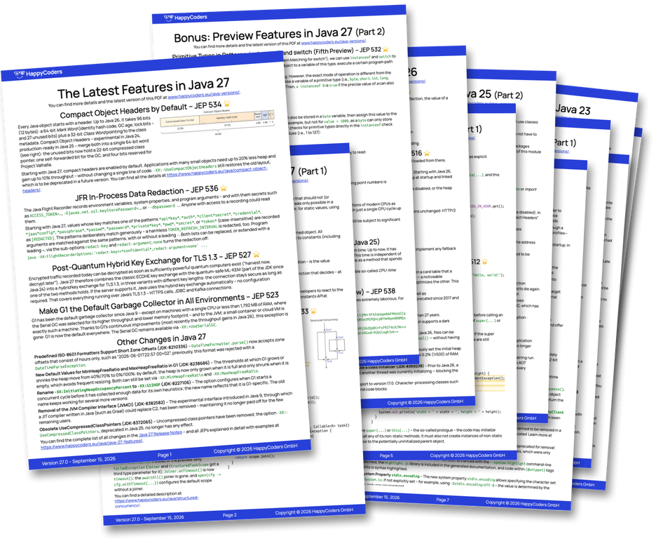
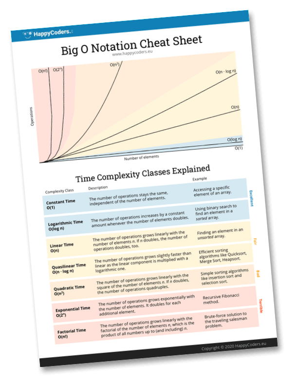

# Java Flight Recorder

[](https://github.com/SvenWoltmann/java-flight-recorder/actions/workflows/build.yml)
[](https://sonarcloud.io/dashboard?id=SvenWoltmann_java-flight-recorder)
[](https://sonarcloud.io/dashboard?id=SvenWoltmann_java-flight-recorder)
[](https://sonarcloud.io/dashboard?id=SvenWoltmann_java-flight-recorder)

The example program of the HappyCoders.eu article "Java Flight Recorder (JFR)" ([English](https://www.happycoders.eu/java/java-flight-recorder/), [German](https://www.happycoders.eu/de/java/java-flight-recorder/)).

Eight worker threads process randomly generated orders for a given number of seconds. A few spots in the code are written clumsily on purpose, the way they turn up in grown code – the article records the program with the Java Flight Recorder and finds each of them with `jfr view` and `jfr print`.

## Running the example

The example uses Java 25 language features and the JFR annotation `@Contextual`, so it needs Java 25 or newer. Build once with `mvn compile`, then record a run of 60 seconds from the repository root:

```
java -XX:StartFlightRecording:filename=orders.jfr,settings=profile \
     -cp target/classes eu.happycoders.jfr.OrderProcessing 60
```

and open the recording, for example with:

```
jfr view hot-methods orders.jfr
```

The article shows many more ways to record and read: `jcmd`, `JFR.view`, `report-on-exit`, the disk and memory ring buffers, method timing, and `-XX:+DebugNonSafepoints` for exact line numbers in the samples.

## Classes

* `OrderProcessing` – the main class; its only argument is the running time in seconds (default 60)
* `OrderService` – processes one order: parses the quantity, checks the product against a list of blocked products, asks the shipping service for the shipping cost, gets an invoice number, formats the receipt, and keeps it in a cache
* `OrderGenerator` – creates random orders with 50 to 149 lines; on average every fifth quantity comes with a unit, such as `"3 pcs"`
* `ShippingService` – an HTTP server in the same process that simulates a remote shipping-cost service answering after 20 ms
* `ShippingClient` – asks the shipping service with `URL.openStream()`
* `InvoiceNumberGenerator` – a `synchronized` generator whose database round trip is simulated with a sleep of 5 ms
* `OrderEvent` – the custom JFR event `eu.happycoders.Order`, one per order, with the order ID as `@Contextual` field
* `MonitoredOrderProcessing` – runs the order processing and prints every order that takes longer than 80 ms, read live with a `RecordingStream`

## Results

`results/outputs-jdk27.txt` holds the outputs of the recording the article analyzes – `jfr summary` and the `jfr view` tables – recorded on JDK 27 on an Apple M5 Pro.


<!-- happycoders-resources:start -->
<!-- Generated from happycoders-website-astro/data/github-readme by scripts/content/sync-github-readmes.mjs. Edit there, not here. -->

## <br>Additional Resources

### <br>Java Versions PDF Cheat Sheet

**Stay up-to-date** with the latest Java features with this **free** [PDF Cheat Sheet](https://www.happycoders.eu/java-versions/)!

[](https://www.happycoders.eu/java-versions/)

* Avoid lengthy research with this **concise overview of all Java versions from Java 10 to Java 27**.
* **Discover the innovative features** of each new Java version, summarized on a single page.
* **Impress your team** with your up-to-date knowledge of the latest Java version.

👉 [Download the free Java Versions PDF](https://www.happycoders.eu/java-versions/)<br>

_(Hier geht's zur deutschen Version &rarr; [Java-Versionen PDF](https://www.happycoders.eu/de/java-versionen/))_


### <br>The Big O Cheat Sheet

With this **free** [1-page PDF cheat sheet](https://www.happycoders.eu/big-o-cheat-sheet/), you'll always have the **7 most important complexity classes** at a glance.

[](https://www.happycoders.eu/big-o-cheat-sheet/)

* **Always choose the most efficient data structures** and thus increase the performance of your applications.
* **Be prepared for technical interviews** and confidently present your algorithm knowledge.
* **Become a sought-after problem solver** and be known for systematically tackling complex problems.

👉 [Download the free Big O Cheat Sheet](https://www.happycoders.eu/big-o-cheat-sheet/)<br>

_(Hier geht's zur deutschen Version &rarr; [O-Notation Cheat Sheet](https://www.happycoders.eu/de/o-notation-cheat-sheet/))_


### <br>HappyCoders Newsletter
👉 Want to stay on top of modern Java?
Sign up for the [HappyCoders newsletter](https://www.happycoders.eu/newsletter/) – Modern Java: new versions & features, performance, and JVM insights – once a month.

_(Hier geht's zur deutschen Version &rarr; [HappyCoders-Newsletter deutsch](https://www.happycoders.eu/de/newsletter/))_


### <br>🇩🇪 An alle Java-Entwickler:innen, die durch fundierte Kenntnisse über Datenstrukturen besseren Code schreiben wollen

Trage dich jetzt unverbindlich auf die [Warteliste](https://www.happycoders.eu/de/mastering-data-structures-warteliste/) von „Mastering Data Structures in Java“ ein, und erhalte das beste Angebot!

[](https://www.happycoders.eu/de/mastering-data-structures-warteliste/)

👉 [Zur Warteliste](https://www.happycoders.eu/de/mastering-data-structures-warteliste/)
<!-- happycoders-resources:end -->
